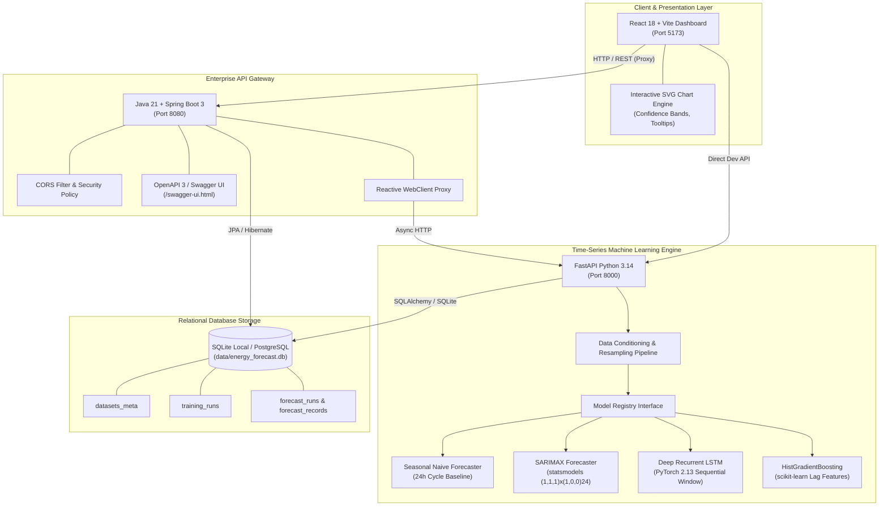
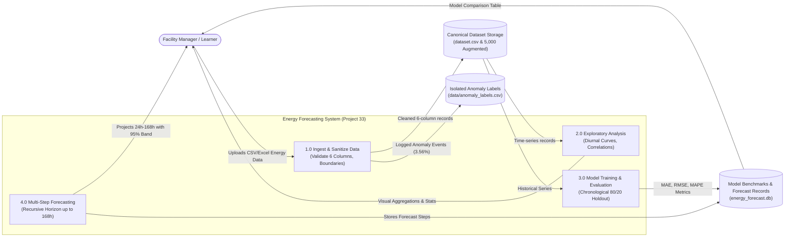

# System Architecture & Data Flow Specification

**Project Title:** Energy Consumption Forecasting Using Time-Series ML  
**Programme:** HCLTech Career Shaper Programme — III Year Industry Project (Project No. 33)  
**Learner:** Rahul Kumar Verma  

---

## 1. High-Level System Architecture

---

## 2. Data Flow Diagram (DFD Level 0)

---

## 3. Database Relational Schema

### `datasets_meta`
- `id` INTEGER PRIMARY KEY AUTOINCREMENT
- `filename` TEXT NOT NULL
- `row_count` INTEGER NOT NULL
- `building_count` INTEGER NOT NULL
- `start_date` TEXT
- `end_date` TEXT
- `created_at` TEXT NOT NULL

### `training_runs`
- `id` INTEGER PRIMARY KEY AUTOINCREMENT
- `run_uuid` TEXT UNIQUE NOT NULL
- `model_name` TEXT NOT NULL
- `building_id` TEXT NOT NULL
- `train_steps` INTEGER NOT NULL
- `test_steps` INTEGER NOT NULL
- `mae` REAL
- `rmse` REAL
- `mape` REAL
- `smape` REAL
- `training_time_sec` REAL
- `status` TEXT NOT NULL
- `created_at` TEXT NOT NULL

### `forecast_runs`
- `id` INTEGER PRIMARY KEY AUTOINCREMENT
- `forecast_uuid` TEXT UNIQUE NOT NULL
- `model_name` TEXT NOT NULL
- `building_id` TEXT NOT NULL
- `horizon_hours` INTEGER NOT NULL
- `start_timestamp` TEXT NOT NULL
- `end_timestamp` TEXT NOT NULL
- `status` TEXT NOT NULL
- `created_at` TEXT NOT NULL

### `forecast_records`
- `id` INTEGER PRIMARY KEY AUTOINCREMENT
- `forecast_uuid` TEXT NOT NULL (Foreign Key)
- `step_number` INTEGER NOT NULL
- `timestamp` TEXT NOT NULL
- `predicted_kWh` REAL NOT NULL
- `lower_bound_kWh` REAL
- `upper_bound_kWh` REAL
